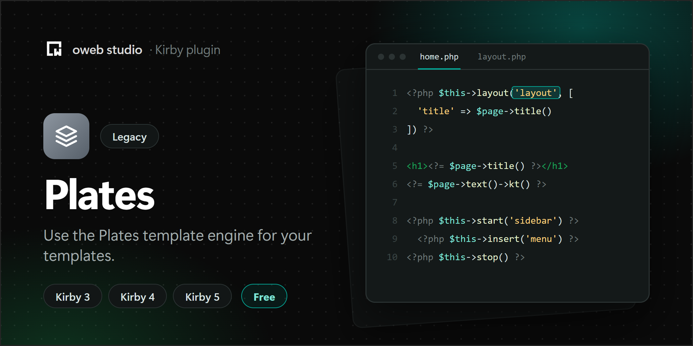

# Kirby Plates

> [!NOTE]
> This plugin is in maintenance mode and only gets security fixes. It supports Kirby 3, 4 and 5. It does not support Kirby 6.
>
> Since Kirby 3.9, Kirby's own [snippets with slots](https://getkirby.com/docs/guide/templates/snippets#passing-slots-to-snippets) and [layout snippets](https://getkirby.com/docs/guide/templates/snippets#passing-slots-to-snippets__layout-snippets) cover most of what Plates layouts and sections do. Kirby 6 adds the `push()` and `stack()` helpers for things like scripts and styles.

This package enable [Plates](https://github.com/thephpleague/plates) that Native PHP template engine/system for your own Kirby applications.

All the documentation about Plates template engine is in the [official documentation](https://platesphp.com/).

## Installation

The download and the Git submodule include Plates 3.6, which needs PHP 8.0 or newer. Composer installs the Plates version that fits your PHP version.

### Installation with composer

### Manual

1. Download the latest release
2. Unzip downloaded file
3. Copy/paste unzipped folder in your `/site/plugins` folder

### With composer

```ssh
composer require owebstudio/kirby-plates
```

### Git submodule

```ssh
git submodule add https://github.com/owebstudio/kirby-plates.git site/plugins/kirby-plates
```

### Sample usage

#### /site/templates/home.php

```php
<?php $this->layout('default') ?>

<h1>User Profile</h1>
<p>Hello, <?=$this->e($name)?></p>


<?php $this->push('scripts') ?>
  <script src="example.js"></script>
<?php $this->end() ?>
```

#### /site/templates/layouts/default.php

```php
<html>
  <head>
    <title><?=$this->e($title)?></title>
  </head>
  <body>
    <?=$this->section('content')?>
    <?= $this->section('scripts') ?>
  </body>
</html>
```
